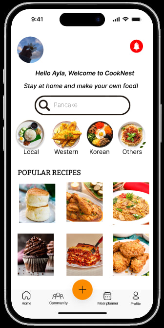
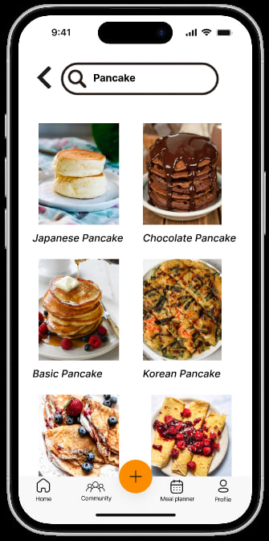
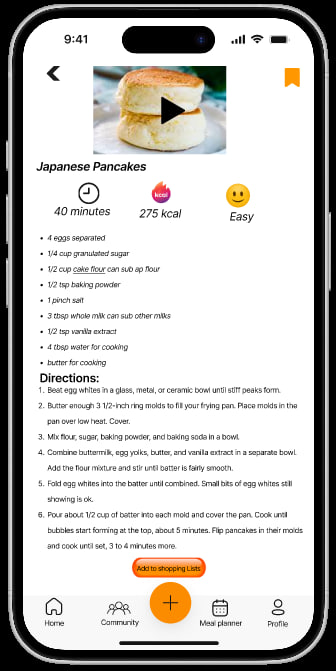
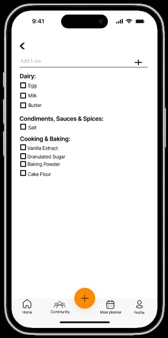
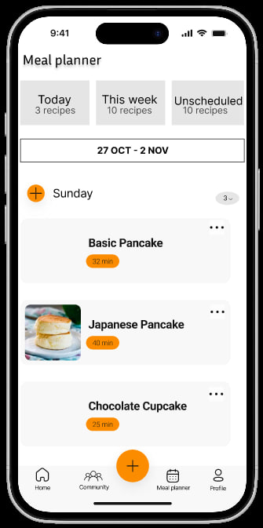
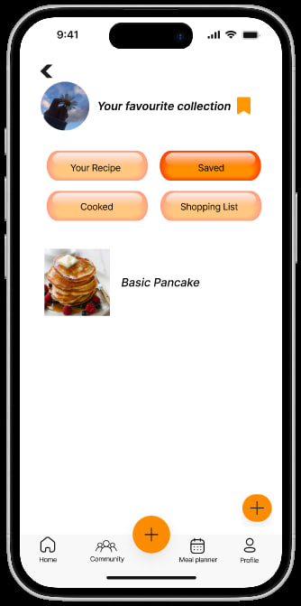

# CookNest – UI/UX Case Study

**Human Computer Interaction (HCI) | Group Project | UNITEN**

CookNest is a mobile cooking recipe application prototype designed to help users discover recipes, save their favourites, create shopping lists and plan meals in one place.

This project was developed as part of the Human Computer Interaction (HCI) course at Universiti Tenaga Nasional (UNITEN).

## My Role

**User Analysis & Task Analysis**

My main contributions to this group project were:

- Working on user analysis to understand the needs, backgrounds and cooking experiences of the target users.
- Identifying user goals, challenges and expectations when using cooking applications.
- Developing task analysis to break down the steps involved in completing the application's main tasks.
- Contributing to the HCI project documentation.

The interactive Figma prototype was developed collaboratively as part of the group project. I was not the primary Figma designer.

## 1. Problem Statement

Cooking applications often focus on individual features, requiring users to switch between different platforms to search for recipes, organize meals and prepare grocery lists.

CookNest was proposed to bring these activities together in one mobile application, making cooking preparation more convenient and organized.

## 2. User Analysis

The project considered six user profiles representing people with different cooking experiences, lifestyles and needs.

The main target groups included:

- Beginners who need clear, step-by-step cooking instructions.
- Students and working professionals who want to save time preparing meals.
- Experienced cooks looking for recipe inspiration and better meal organization.
- Users who prefer simple navigation and convenient access to recipes.

The analysis helped identify important user needs, including easy recipe discovery, saving favourite recipes, shopping list organization and meal planning.

## 3. Task Analysis

Hierarchical Task Analysis (HTA) was used to break down four key user tasks into smaller steps.

**Task 1: Search for a Recipe**

Identify how users navigate the application, enter recipe keywords, browse results and select a recipe.

**Task 2: Save a Recipe**

Identify the steps required to select a recipe and save it for future reference.

**Task 3: Create a Shopping List**

Break down the process of selecting a recipe, reviewing its ingredients and adding items to a shopping list.

**Task 4: Plan Meals for Specific Dates**

Identify how users select meals and organize them within a meal planner.

These task analyses helped the team understand the interactions required to support the application's main features.

## 4. Prototype Screens

The group developed a mid-fidelity interactive prototype using Figma.

### Home Screen

### Recipe Search

### Recipe Details

### Shopping List

### Meal Planner

### Saved Recipes

## 5. Design Approach

The project applied Human-Computer Interaction concepts, including:

- **User-Centred Design :** Considering user needs and behaviours when planning the application.
- **Task Analysis :** Understanding how users complete important activities.
- **Prototyping :** Using an interactive prototype to demonstrate the proposed interface and user flows.
- **Consistency :** Maintaining familiar navigation and interface elements across screens.
- **Usability Considerations :** Planning how the prototype could be evaluated and improved through user feedback.

## 6. Limitations and Future Improvements

As an academic prototype, CookNest had limitations, including a limited recipe selection and areas requiring further accessibility and usability improvements.

Potential future improvements include more personalized recipe recommendations, offline access, improved accessibility and additional community features.

## 7. What I Learned

This project helped me understand that designing an application involves more than creating an attractive interface.

Through user analysis and task analysis, I learned how important it is to understand users' needs, identify their goals and break down their activities into manageable steps before designing a solution.

It also gave me exposure to user-centred design and the role of research and planning in creating a better user experience.

## Prototype

[View CookNest Interactive Figma Prototype](https://www.figma.com/proto/PbUDSsO2wzM9gWXxAHaXQU/CookNest--Copy)

**Note:** This repository documents an academic group UI/UX project. It contains prototype screenshots and a case study, not a fully developed mobile application.
